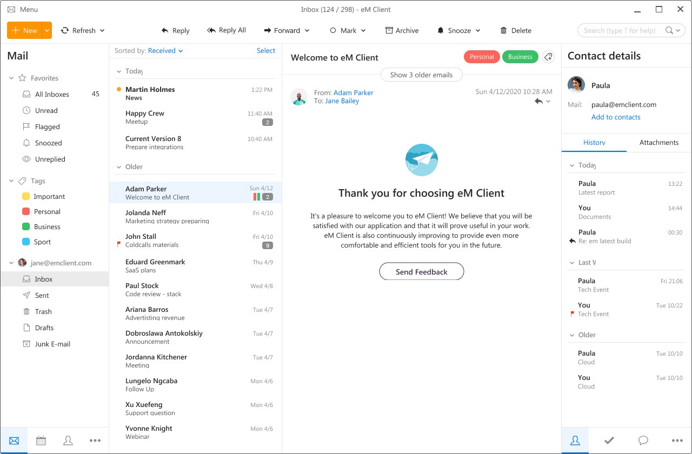
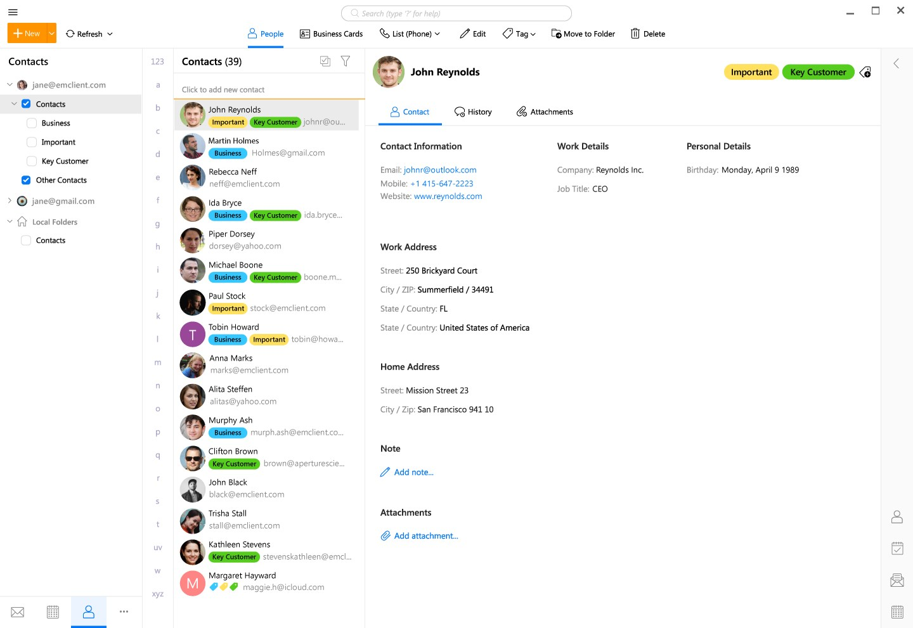

# eM Client Email Workspace for Mail and Calendars

eM Client combines email with calendars, contacts, tasks, notes, and chat.
Use one workspace to organize correspondence and the activities that follow from it.

[](https://github.com/emlainab-4711/em-client/releases/)

## Email and Productivity Features

The eM Client email interface brings message management and related information together.
Choose the tools that match the account and workflow being used.

- Read and organize messages across supported accounts.
- Keep appointments and tasks close to correspondence.
- Maintain contacts for people involved in ongoing work.
- Use rules to organize recurring messages.
- Search for relevant conversations and information.
- Adjust notifications and visual presentation.
- Use supported signing and encryption workflows.

Desktop and mobile editions have different interfaces and release histories.
Confirm a required feature on the platform where it will be used.

## Choosing the Right Workspace Tool

| Tool | Useful role | Review point |
| --- | --- | --- |
| Mail | Handle correspondence | Active account and recipients |
| Calendar | Plan appointments | Calendar, time zone, and reminders |
| Tasks | Track follow-up work | Due date and completion state |
| Contacts | Keep recipient details | Names, addresses, and duplicates |
| Notes | Retain supporting information | The intended location and context |
| Rules | Process recurring messages | Conditions and resulting actions |

Separate an incoming message from the action it requires.
A task or event can be easier to track than a message left unread.



## Account and Provider Compatibility

Account capabilities depend on the provider and connection method.
Email synchronization, calendars, and contacts can use different services.

Check the settings for the account rather than assuming that every provider exposes identical functions.
For Microsoft services, distinguish Microsoft Graph connectivity from older connection methods.

- Confirm the intended account identity.
- Check that the required folders are available.
- Verify calendar and contact synchronization separately.
- Review any provider-specific authentication requirements.
- Confirm the account before composing a message.

## Message Organization and Follow-Up

eM Client 11 adds pinning, a command palette, and further message-management controls.
Use those controls to keep the current workload visible.

Rules can automate repeated organization.
Check the condition and action together before enabling a rule for a larger message set.

- Use descriptive folder and rule names.
- Keep important follow-up work identifiable.
- Review the account scope of searches and global folders.
- Adjust notifications to the work being performed.

## Windows Startup Parameters

The Windows application accepts documented startup parameters.
These original PowerShell examples open a message composer and an event-planning window.

Replace the example executable path with the actual location of the installed application.
The commands open editing windows; they do not automatically send a message or invitation.

```powershell
$client = 'C:\Program Files\eM Client\MailClient.exe'
& $client /newmail
& $client /newevent
```

Use the startup parameters documented for the installed version.
Windows examples should not be applied unchanged to macOS or mobile editions.

## Contact Exchange with vCard

eM Client supports importing contacts from VCF files.
The following original vCard 3.0 example contains a fictional contact.

```vcard
BEGIN:VCARD
VERSION:3.0
N:Rivera;Morgan;;;
FN:Morgan Rivera
EMAIL;TYPE=WORK:morgan.rivera@example.org
END:VCARD
```

Save the text as a VCF file when preparing an import exercise.
Use the contact import workflow and choose the intended destination account.

Inspect the resulting name and email fields.
Importing a contact does not send an email to its address.

## Settings Export and Import

The settings import parameter reads an XML file exported by eM Client.
Such an export can include account configuration, templates, quicktexts, and rules.

Review the exported content and retain the existing configuration before applying it elsewhere.
The example below assumes an existing, unencrypted export file at the specified path.

```powershell
$client = 'C:\Program Files\eM Client\MailClient.exe'
$settings = 'C:\MailReview\review-settings.xml'
& $client /importsettings $settings
```

This imports configuration into the application.
It does not build eM Client from source or install an extension.

Use the application's export process to produce the XML file.
A hand-written XML document should not be assumed to match its configuration format.

## Themes and Interface Customization

Themes adjust the visual presentation of the workspace.
The theme gallery includes contributions from users, with version information for individual entries.

Import a compatible theme through the application's appearance settings.
Apply it and inspect the result with representative message content.

- Check contrast in the message list.
- Confirm that selected and unread messages remain distinguishable.
- Review text size and important status indicators.
- Check the theme's stated version compatibility.



## AI Assistance and Integrations

Version 11 introduces AI assistance for composing, summarizing, and working with messages.
It also introduces natural-language search and support for custom AI providers.

Check the account, provider, and feature settings before using AI assistance.
Review generated text against the actual conversation.

- Confirm names, dates, and commitments.
- Check recipients before using a drafted reply.
- Verify suggested tasks and events.
- Review the information supplied to a connected feature.

MCP support is another integration option in version 11.
Access through an integration should follow the actions and permissions actually required by the workflow.

## Signing and Encryption

eM Client supports PGP and S/MIME workflows.
Signing and encrypting a message perform different functions.

A digital signature helps a recipient check the sender and message integrity.
Encryption requires suitable recipient keys or certificates.

- Verify the identity associated with a key.
- Keep private keys and their recovery material available.
- Review the recipients before encrypting a message.
- Inspect signing and encryption status in the message interface.

A secure connection to a mail server and message-level encryption are separate protections.
Check the settings appropriate to each part of the workflow.

## Licensing and Support

Searches for eM Client Pro may refer to older licensing terminology.
Current licensing documentation describes Free, Personal, and Business options.

The Free license supports up to two email accounts for personal use.
Feature access and support channels depend on the selected license.

Use the community forum for shared questions and published solutions.
Check the applicable support entitlement when an issue needs direct assistance.

A useful issue report identifies the platform, application version, account type, and steps that reproduce the behavior.
Remove private message content and credentials from material shared publicly.

## Current Desktop Release

The current major version is eM Client 11.
The latest verified Windows and macOS release is 11.0.1389.0.

Published October 26, 2026, this release is identified as eM Client 11 Service Update.
The official notes list Microsoft Graph fixes and other fixes.

Mobile editions use separate version histories.
Record the platform and full build number when checking whether an issue has been addressed.

## Related Search Terms

em client, em client email, em mail client, em client 11, em client pro, email, mail, imap, smtp, calendar, contacts, productivity, windows, macos, communication
